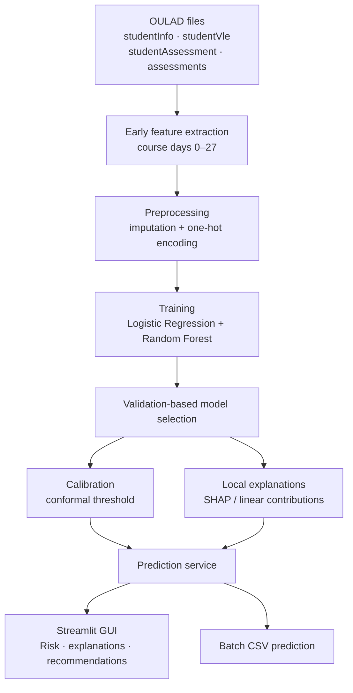
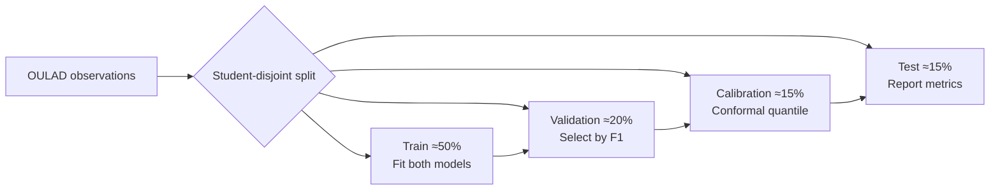
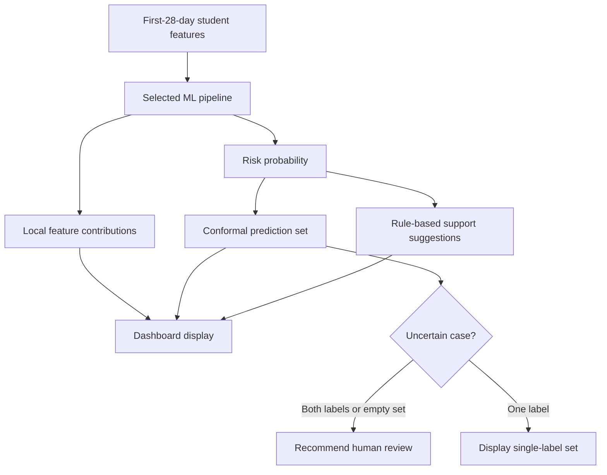
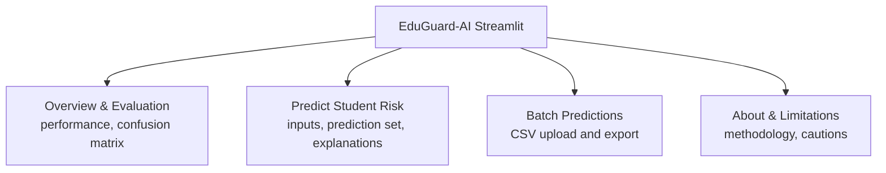
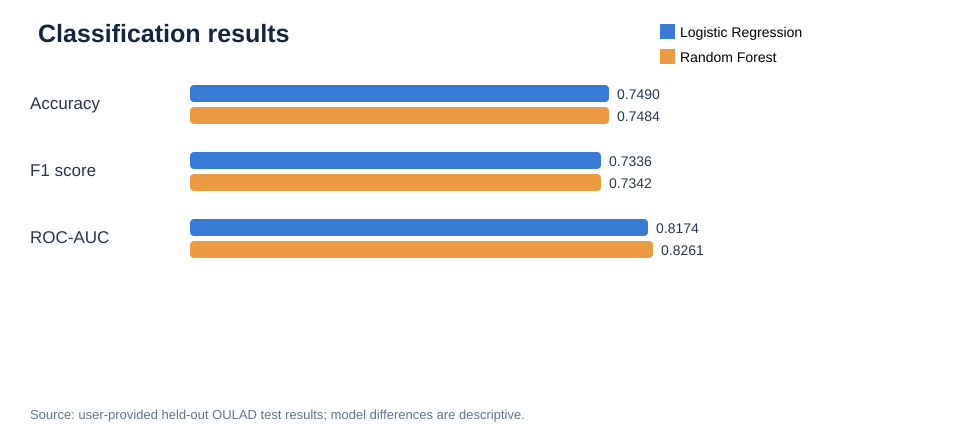
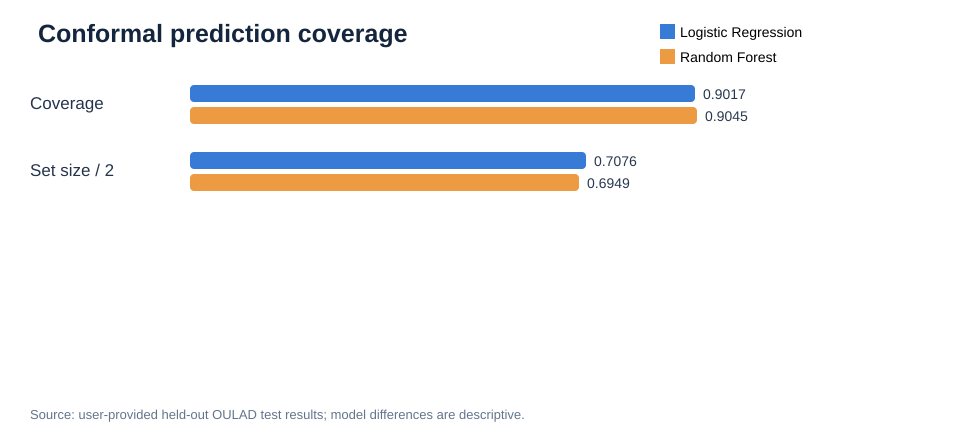

# EduGuard-AI: An Explainable and Uncertainty-Aware Academic Risk Prediction System

**Advanced Artificial Intelligence — Master's Course Project Report**

**Submitted by:** [Student name and ID]  
**Department:** [Department]  
**University:** [University]  
**Submitted to:** [Course instructor]  
**Date:** [Submission date]

---

## Abstract

Early identification of students who may fail or withdraw from a course can inform timely academic support. EduGuard-AI is a Python-based research prototype combining supervised learning, local explanations, uncertainty-aware prediction sets, and a Streamlit dashboard. It uses the Open University Learning Analytics Dataset (OULAD) to derive early course indicators from days 0–27, plus available course and prior-attempt information. Logistic Regression and Random Forest are trained on student-disjoint data, and the preferred model is selected using validation F1-score. A separate calibration partition supports split conformal prediction, while an untouched test partition is used for evaluation. Local explanations use SHAP for Random Forest and linear coefficient contributions for Logistic Regression. The dashboard supports individual assessment, evaluation charts, CSV batch predictions, and rule-based academic support suggestions. The prototype demonstrates integration of prediction, interpretability, and uncertainty estimation; it is not validated for autonomous student decisions.

**Keywords:** Educational data mining; Explainable AI; OULAD; SHAP; conformal prediction; academic early warning; Streamlit.

## 1. Introduction

Educational institutions increasingly collect assessments, academic records, and virtual learning environment (VLE) activity. These records can support early-warning models, but numerical predictions alone are insufficient for responsible use. Users also need interpretable indicators and explicit acknowledgement of uncertainty. EduGuard-AI integrates these capabilities into a course project suitable for demonstrating advanced AI methods.

### 1.1 Objectives

1. Build a reproducible early-course student academic-risk classifier.
2. Compare Logistic Regression and Random Forest on disjoint evaluation data.
3. Explain the selected model's individual predictions.
4. Report conformal prediction sets alongside risk scores.
5. Deliver a graphical interface with individual and batch prediction workflows.

### 1.2 Scope and outcome definition

The binary outcome is **at risk = Fail or Withdrawn**, **not at risk = Pass or Distinction**. This is a retrospective classification of *eventual final results* using early-course observations; it is not a diagnosis, a causal model, or a policy for automatically intervening with students.

## 2. Background and Literature Review

### 2.1 Educational data mining and early-warning systems

Educational data mining (EDM) and learning analytics study how academic records and online learning behavior can be used to understand student progress and anticipate difficulties. Predicting an adverse final outcome from information available early in a course may help educators prioritize supportive contact; however, the prediction itself does not demonstrate that any particular intervention will improve outcomes. A 2025 systematic review by Shi and colleagues surveyed a decade of machine-learning applications for identifying at-risk learners in online education and emphasized the importance of consistent risk definitions and careful interpretation of model strengths and limitations [8].

### 2.2 The OULAD dataset and early-course indicators

Kuzilek, Hlosta, and Zdrahal introduced the Open University Learning Analytics Dataset (OULAD), linking student information, assessment records, and virtual learning environment (VLE) activity [1]. Its combination of course outcomes and timestamped online engagement makes it suitable for retrospective early-warning experiments. The original dataset covers 22 course presentations and 32,593 student records, together with a large collection of daily VLE interaction summaries [1].

Because final grades or future assessment information would leak knowledge unavailable at prediction time, EduGuard-AI uses only VLE activity and eligible assessments from course days 0–27, alongside existing student/course information. The target is eventual **Fail/Withdrawn** versus **Pass/Distinction**. This cutoff defines an early prediction task, but a retrospective grouped split does not by itself prove generalization to future cohorts or different institutions.

### 2.3 Predictive models for student risk

Research on academic-risk and dropout prediction frequently uses Logistic Regression, decision trees, Random Forest, and gradient boosting because these approaches work well with structured records and are relatively practical to deploy. Breiman's Random Forest framework combines multiple decision trees to learn complex nonlinear relationships while reducing dependence on a single tree [2]. Logistic Regression provides a useful lower-complexity baseline and a direct relationship between transformed features and log-odds.

A 2026 systematic review by Boujmiraz, Darhmaoui, and Drissi el Maliani synthesized 72 studies of student-performance prediction and reported extensive use of tree-based models and neural networks, while noting a growing but still incomplete emphasis on explainability [9]. A separate 2026 review of higher-education dropout prediction highlighted limited cross-institution generalizability, insufficient attention to fairness, and challenges in moving predictive systems into actual institutional practice [10]. These observations support comparing an interpretable baseline with a nonlinear ensemble rather than assuming that a more complicated model must be superior.

### 2.4 Explainable AI for educational decisions

A prediction score provides limited practical context unless instructors can examine what the model relied on. Lundberg and Lee proposed SHAP (SHapley Additive exPlanations), which expresses individual predictions using additive feature contributions [3]. In EduGuard-AI, SHAP is applied to Random Forest predictions, while Logistic Regression displays transformed-feature coefficient contributions. This approach enables inspection of learned predictors such as online activity and early assessment performance.

Nevertheless, feature attribution measures the contribution to a **model prediction**, not the causal effect of changing a student's behavior. A systematic review of university dropout prediction and explainability covering research from 2012–2024 likewise underlined the importance of moving beyond predictive performance when interpreting risk factors [11]. For this reason, EduGuard-AI treats its academic support suggestions as transparent, rule-based prompts for human review, not validated interventions.

### 2.5 Uncertainty-aware machine learning

Many student-risk systems present a binary class or a probability without indicating how reliably that label should be interpreted. Conformal prediction offers a complementary way to express uncertainty: a separate calibration dataset is used to construct candidate-label sets with nominal marginal coverage under exchangeability assumptions. The foundational framework was developed by Vovk, Gammerman, and Shafer [4], and Angelopoulos and Bates provide a modern practical introduction to conformal uncertainty quantification [12].

EduGuard-AI applies split conformal prediction at significance level 0.10. Depending on the calibrated threshold, a prediction set may contain one, both, or neither of the candidate academic outcomes. Coverage must be reported together with average set size: including both labels frequently may improve coverage at the cost of informative decisions. Validity may also weaken when deployment students differ substantially from calibration students.

### 2.6 Research gap and positioning of EduGuard-AI

Prior research establishes that academic-risk prediction is feasible, but recurring challenges concern the interpretation, reliability, and practical use of model outputs [8]–[11]. EduGuard-AI addresses an **integration and reproducibility gap** at course-project scale rather than claiming a newly invented learning algorithm. Its distinctive combination is:

1. Early-window features restricted to the first 28 course days.
2. A comparison between Logistic Regression and Random Forest with validation-based model selection.
3. A separate calibration partition for uncertainty-aware conformal prediction sets.
4. Local explanations and transparent, human-reviewed support suggestions.
5. A reproducible Streamlit interface for individual and batch risk assessment.

The project does not claim to establish a state-of-the-art benchmark, causal effectiveness of recommendations, or prospective deployment readiness.

### 2.7 Summary of selected literature

| Study | Primary contribution | Relevance to EduGuard-AI |
|---|---|---|
| Kuzilek et al. (2017) [1] | OULAD dataset linking academic records and VLE activity | Dataset and early learning indicators |
| Breiman (2001) [2] | Random Forest ensemble learning | Nonlinear classification baseline |
| Lundberg and Lee (2017) [3] | SHAP explanation framework | Local interpretability |
| Shi et al. (2025) [8] | Review of at-risk prediction in online education | Problem formulation and evaluation caution |
| Boujmiraz et al. (2026) [9] | Review of ML, deep learning, and XAI for student performance | Predictive modeling and explainability context |
| Higher-education dropout review (2026) [10] | Synthesis of modeling, interpretability, and deployment limitations | Responsible-use considerations |
| Angelopoulos and Bates (2023) [12] | Introduction to conformal uncertainty quantification | Calibration and prediction-set methodology |

## 3. Proposed Architecture

**Figure 1. EduGuard-AI system architecture**

### 3.1 Functional modules

The application provides four views: **Overview & Evaluation**, **Predict Student Risk**, **Batch Predictions**, and **About & Limitations**. Inference uses a saved scikit-learn pipeline. Streamlit renders model comparison, confusion matrix, model-based explanation plots, and export controls.

## 4. Dataset and Preparation

OULAD consists of anonymized student academic and activity records. The implemented loader uses four files:

| Source | Role |
|---|---|
| `studentInfo.csv` | Final outcome, studied credits, previous attempts and identifiers |
| `studentVle.csv` | Interaction counts and active learning days |
| `studentAssessment.csv` | Submission dates and assessment scores |
| `assessments.csv` | Assessment type and scheduled dates |

### 4.1 Features

The model uses eight columns: `num_of_prev_attempts`, `studied_credits`, `early_clicks`, `active_days`, `early_submissions`, `early_mean_score`, `code_module`, and `code_presentation`.

Only VLE activity from days 0–27 is aggregated. Early assessment features require submissions within the early window and qualifying assessment dates. Missing numerical values are imputed; categorical values undergo one-hot encoding. The loader coerces assessment dates to numeric values, treating invalid entries as missing.

### 4.2 Experimental partitions

The implemented process uses `GroupShuffleSplit` with student IDs as groups, yielding approximately **50% train, 20% validation, 15% calibration, and 15% test**.

**Figure 2. Model development and evaluation workflow**

Because final outcome labels are available retrospectively, testing must be interpreted as **early-window prediction of eventual course outcomes**, not a live prospective trial.

## 5. AI Methodology

### 5.1 Classification

The Logistic Regression model uses class weighting and a maximum of 1,500 iterations. Random Forest uses 180 trees, maximum depth 15, minimum leaf size 5, and class weighting. Both pipelines include imputation and categorical encoding.

For student features `x`, the classifier produces `p = P(y=1 | x)`. A probability threshold of 0.5 gives a binary label. Model selection uses **validation F1**, never test-set metrics.

### 5.2 Conformal prediction

For calibration item `(x_i,y_i)`, nonconformity is:

`s_i = 1 − P_hat(y_i | x_i)`.

The program calculates a finite-sample-adjusted cutoff at significance level **alpha = 0.10**, then forms a prediction set from candidate labels satisfying that cutoff. Prediction sets may contain zero, one, or both classes. The 90% target describes **marginal coverage under exchangeability**; it is not a 90% guarantee for each individual.

**Figure 3. Decision-support inference flow**

### 5.3 Explainability

For Random Forest, SHAP reports local feature contributions. For Logistic Regression, the implementation shows transformed-feature contributions derived from coefficients. They explain model computation, **not causal effects**. Academic support suggestions are rule-based and require instructor review.

## 6. Implementation

| Item | Tool |
|---|---|
| Language and environment | Python, Google Colab |
| Learning algorithms | scikit-learn |
| Data processing | Pandas, NumPy |
| Local explainability | SHAP |
| Visualizations | Plotly |
| User interface | Streamlit |
| Storage | Joblib model, JSON metrics, CSV examples |
| Version control | GitHub |

**Figure 4. Streamlit application modules**

### 6.1 Source-code organization

`app.py` implements the interface; `train.py` starts training; `eduguard/data.py` prepares OULAD features; `eduguard/model.py` trains and evaluates models, applies conformal calibration, and provides inference and local explanations. The Google Colab notebook automates setup and execution.

## 7. Experimental Results and Evaluation

**Reported run:** The following figures are the real OULAD test results provided from the completed Colab training output. Additional metrics not included in that output remain unreported rather than estimated. The selected model was **Random Forest**, chosen on validation F1-score (not by test accuracy).

**Table 1. Held-out OULAD test-set results**

| Metric | Logistic Regression | Random Forest |
|---|---:|---:|
| Accuracy | 0.7490 (74.90%) | 0.7484 (74.84%) |
| F1-score | 0.7336 | **0.7342** |
| ROC-AUC | 0.8174 | **0.8261** |
| Conformal coverage | 0.9017 (90.17%) | **0.9045 (90.45%)** |
| Mean prediction-set size | 1.4151 | **1.3899** |

**Figure 5. Held-out OULAD classification performance**

**Figure 6. Split conformal coverage and prediction-set size**

*In Figure 6, mean set size is divided by two solely for display on a shared 0–1 axis (two candidate labels); the unscaled values are given in Table 1.*

### 7.1 Analysis of the observed results

Both classifiers yielded similar predictive classification performance. Logistic Regression achieved slightly higher accuracy (**74.90%** versus **74.84%**), a difference of **0.06 percentage points**. Random Forest achieved a slightly higher F1-score (**0.7342** versus **0.7336**) and a higher ROC-AUC (**0.8261** versus **0.8174**). The ROC-AUC advantage of 0.0087 suggests somewhat better ranking performance on this held-out partition, but statistical significance cannot be established from a single test run.

At the configured **90% nominal marginal coverage**, both conformal predictors attained coverage close to target: **90.17%** for Logistic Regression and **90.45%** for Random Forest. Random Forest also achieved a smaller mean prediction-set size (**1.3899** instead of **1.4151**), suggesting slightly more informative prediction sets on the evaluated records. Coverage alone is not a measure of student-level certainty, and these figures do not guarantee performance after deployment or distribution shift.

The Random Forest model was selected by validation F1-score; the test-set results are presented for independent comparison. Precision, recall, balanced accuracy, Brier score and confusion matrix values were not supplied in this run and should be extracted directly from `models/metrics.json` if required for the final report.

### 7.2 Graphical user interface figures

The repository does not contain captured images from a running Colab/Streamlit browser. The following **labeled illustrations** show the actual intended interface sections and are not represented as authentic runtime screenshots. Replace them with browser captures before claiming they are screenshots in a final university submission.

**Figure 7. Overview and Evaluation interface (illustrative layout)**

**Figure 8. Individual student risk analysis interface (illustrative layout)**

**Figure 9. Batch CSV prediction interface (illustrative layout)**

#### Capturing authentic screenshots in Google Colab

1. Run the real OULAD training notebook and open the Streamlit dashboard in a browser tab.
2. Capture the **Overview & Evaluation** page with real model metrics visible.
3. Capture the **Predict Student Risk** page after selecting and analyzing an example record, including the conformal set and explanation visualization.
4. Capture the **Batch Predictions** page after uploading a CSV (remove or blur any sensitive student identifiers).
5. Save images as `report_figures/real_overview.png`, `report_figures/real_student.png`, and `report_figures/real_batch.png`; upload them to GitHub, and replace the corresponding image paths in this report.

### 7.3 Interpretation guidance

Compare F1-score and recall to investigate missed at-risk cases, inspect precision to understand false alerts, and use Brier score for probability quality. Conformal coverage must be interpreted jointly with average set size and ambiguous-set rate: a large prediction set can cover well while remaining uninformative.

The models are close in accuracy and F1-score. Their relative performance should be further evaluated across multiple random seeds and course-presentation splits.

## 8. Limitations and Responsible Use

The project is limited by one observational dataset, few early predictors, and possible dataset shift. Enrollment/course characteristics and learned associations may not generalize to other institutions. SHAP or coefficient contributions do not demonstrate causal influence. Conformal coverage can deteriorate if deployment data depart from calibration data. Fairness, informed institutional use, student privacy, and careful human review would be needed before any practical deployment.

## 9. Future Work

Possible extensions include time-aware external validation, group fairness analysis, robust temporal features, stronger benchmarks such as gradient boosting, monitoring of distribution drift, and evidence-based evaluation of academic support interventions.

## 10. Conclusion

EduGuard-AI implements a reproducible early academic-risk prediction pipeline with model comparison, feature-level explanations, conformal prediction sets, and an accessible Streamlit interface. Its main contribution is a practical integration of **prediction, explanation, uncertainty, and decision support**. The project demonstrates advanced AI principles but does not establish prospective effectiveness or justify fully automated student intervention.

## References

[1] J. Kuzilek, M. Hlosta, and Z. Zdrahal, “Open University Learning Analytics Dataset,” *Scientific Data*, 4, 170171, 2017. https://doi.org/10.1038/sdata.2017.171

[2] L. Breiman, “Random Forests,” *Machine Learning*, 45, 5–32, 2001. https://doi.org/10.1023/A:1010933404324

[3] S. M. Lundberg and S.-I. Lee, “A Unified Approach to Interpreting Model Predictions,” *NeurIPS*, 2017.

[4] V. Vovk, A. Gammerman, and G. Shafer, *Algorithmic Learning in a Random World*, Springer, 2005.

[5] F. Pedregosa et al., “Scikit-learn: Machine Learning in Python,” *JMLR*, 12, 2825–2830, 2011.

[6] Open University Learning Analytics Dataset, UCI Machine Learning Repository. https://archive.ics.uci.edu/dataset/349/open+university+learning+analytics+dataset

[7] Streamlit documentation. https://docs.streamlit.io/

[8] Y. Shi et al., “Applications of Machine Learning for at-Risk Student Prediction in Online Education: A 10-Year Systematic Review of Literature,” *Journal of Computer Assisted Learning*, vol. 41, no. 4, 2025. https://doi.org/10.1111/jcal.70058

[9] S. Boujmiraz, H. Darhmaoui, and A. Drissi el Maliani, “Predicting student performance: A comprehensive review of machine learning, deep learning, and explainable AI approaches,” *Computers and Education: Artificial Intelligence*, article 100548, 2026. https://doi.org/10.1016/j.caeai.2026.100548

[10] “Machine Learning and Deep Learning for Dropout Prediction in Higher Education: A Review,” *Computers*, vol. 15, no. 3, article 164, 2026. https://doi.org/10.3390/computers15030164

[11] “Factors, Prediction, Explainability, and Simulating University Dropout Through Machine Learning: A Systematic Review, 2012–2024,” *Computation*, vol. 13, no. 8, article 198, 2025. https://www.mdpi.com/2079-3197/13/8/198

[12] A. N. Angelopoulos and S. Bates, “A Gentle Introduction to Conformal Prediction and Distribution-Free Uncertainty Quantification,” *Foundations and Trends in Machine Learning*, 2023. https://arxiv.org/abs/2107.07511

## Appendix A. Project code and Colab

- GitHub: https://github.com/cseteesta-bit/EduGuard-AI
- Colab: https://colab.research.google.com/github/cseteesta-bit/EduGuard-AI/blob/main/EduGuard-AI-GitHub-Colab.ipynb

## Appendix B. Report figure index

| Figure | Content | Evidence type |
|---|---|---|
| 1 | System architecture | Architecture diagram |
| 2 | Model development workflow | Methodology diagram |
| 3 | Inference and uncertainty workflow | Methodology diagram |
| 4 | Streamlit module organization | Application design diagram |
| 5 | Classification model comparison | Reported OULAD test results |
| 6 | Conformal coverage and set size | Reported OULAD test results |
| 7 | Overview dashboard illustration | Illustrative, not a runtime capture |
| 8 | Student risk form illustration | Illustrative, not a runtime capture |
| 9 | Batch prediction illustration | Illustrative, not a runtime capture |

## Appendix C. Submission checklist

- [ ] Complete cover-page details.
- [x] Add the five reported real-data metrics from the Colab output.
- [ ] Add remaining metrics and confusion matrix from `models/metrics.json` if required.
- [x] Add labeled interface illustrations; actual runtime screenshots are still required for a screenshot-based submission.
- [ ] Verify references, page numbering, and local academic formatting.
