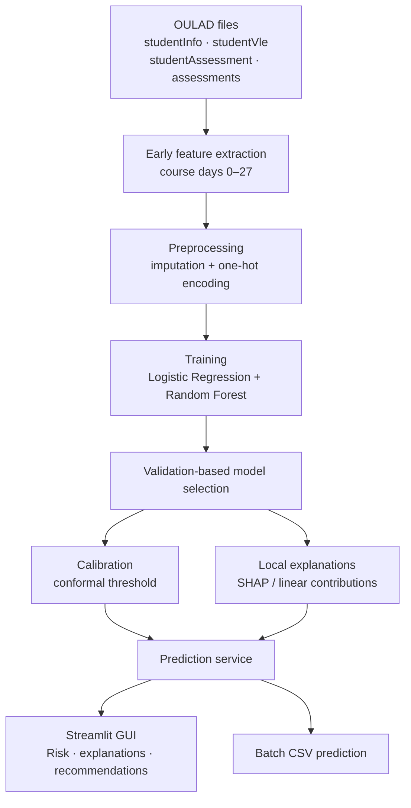
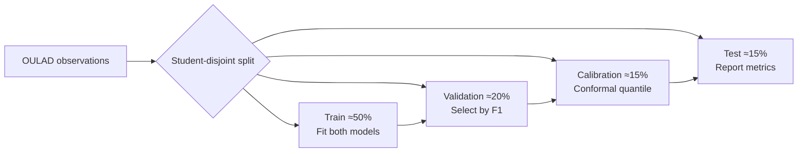
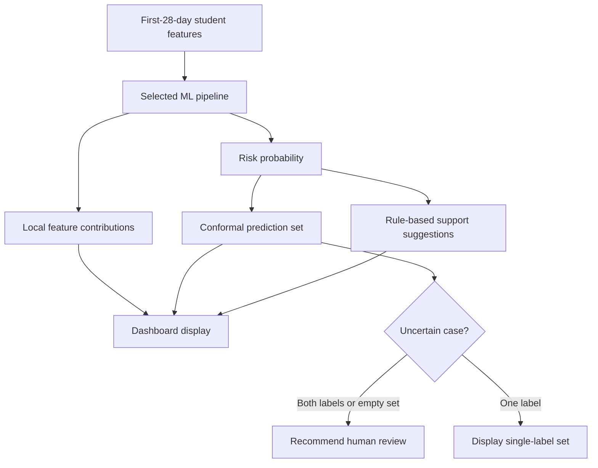
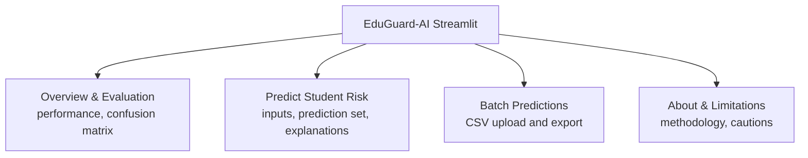

# EduGuard-AI: An Explainable and Uncertainty-Aware Academic Risk Prediction System

**Advanced Artificial Intelligence — Master's Course Project Report**

**Submitted by:** [Student name and ID]  
**Department:** [Department]  
**University:** [University]  
**Submitted to:** [Course instructor]  
**Date:** [Submission date]

---

## Abstract

Early identification of students who may fail or withdraw from a course can inform timely academic support. EduGuard-AI is a Python-based research prototype combining supervised learning, local explanations, uncertainty-aware prediction sets, and a Streamlit dashboard. It uses the Open University Learning Analytics Dataset (OULAD) to derive early course indicators from days 0–27, plus available course and prior-attempt information. Logistic Regression and Random Forest are trained on student-disjoint data, and the preferred model is selected using validation F1-score. A separate calibration partition supports split conformal prediction, while an untouched test partition is used for evaluation. Local explanations use SHAP for Random Forest and linear coefficient contributions for Logistic Regression. The dashboard supports individual assessment, evaluation charts, CSV batch predictions, and rule-based academic support suggestions. The prototype demonstrates integration of prediction, interpretability, and uncertainty estimation; it is not validated for autonomous student decisions.

**Keywords:** Educational data mining; Explainable AI; OULAD; SHAP; conformal prediction; academic early warning; Streamlit.

## 1. Introduction

Educational institutions increasingly collect assessments, academic records, and virtual learning environment (VLE) activity. These records can support early-warning models, but numerical predictions alone are insufficient for responsible use. Users also need interpretable indicators and explicit acknowledgement of uncertainty. EduGuard-AI integrates these capabilities into a course project suitable for demonstrating advanced AI methods.

### 1.1 Objectives

1. Build a reproducible early-course student academic-risk classifier.
2. Compare Logistic Regression and Random Forest on disjoint evaluation data.
3. Explain the selected model's individual predictions.
4. Report conformal prediction sets alongside risk scores.
5. Deliver a graphical interface with individual and batch prediction workflows.

### 1.2 Scope and outcome definition

The binary outcome is **at risk = Fail or Withdrawn**, **not at risk = Pass or Distinction**. This is a retrospective classification of *eventual final results* using early-course observations; it is not a diagnosis, a causal model, or a policy for automatically intervening with students.

## 2. Background

**Random Forest** aggregates decision trees to model nonlinear relationships. **Logistic Regression** models the log odds of a binary outcome and provides a useful baseline. **Explainable AI** methods provide local contributions describing a model's behavior. **Split conformal prediction** derives a prediction-set cutoff from held-out calibration data and provides nominal marginal coverage under exchangeability.

## 3. Proposed Architecture

**Figure 1. EduGuard-AI system architecture**

### 3.1 Functional modules

The application provides four views: **Overview & Evaluation**, **Predict Student Risk**, **Batch Predictions**, and **About & Limitations**. Inference uses a saved scikit-learn pipeline. Streamlit renders model comparison, confusion matrix, model-based explanation plots, and export controls.

## 4. Dataset and Preparation

OULAD consists of anonymized student academic and activity records. The implemented loader uses four files:

| Source | Role |
|---|---|
| `studentInfo.csv` | Final outcome, studied credits, previous attempts and identifiers |
| `studentVle.csv` | Interaction counts and active learning days |
| `studentAssessment.csv` | Submission dates and assessment scores |
| `assessments.csv` | Assessment type and scheduled dates |

### 4.1 Features

The model uses eight columns: `num_of_prev_attempts`, `studied_credits`, `early_clicks`, `active_days`, `early_submissions`, `early_mean_score`, `code_module`, and `code_presentation`.

Only VLE activity from days 0–27 is aggregated. Early assessment features require submissions within the early window and qualifying assessment dates. Missing numerical values are imputed; categorical values undergo one-hot encoding. The loader coerces assessment dates to numeric values, treating invalid entries as missing.

### 4.2 Experimental partitions

The implemented process uses `GroupShuffleSplit` with student IDs as groups, yielding approximately **50% train, 20% validation, 15% calibration, and 15% test**.

**Figure 2. Model development and evaluation workflow**

Because final outcome labels are available retrospectively, testing must be interpreted as **early-window prediction of eventual course outcomes**, not a live prospective trial.

## 5. AI Methodology

### 5.1 Classification

The Logistic Regression model uses class weighting and a maximum of 1,500 iterations. Random Forest uses 180 trees, maximum depth 15, minimum leaf size 5, and class weighting. Both pipelines include imputation and categorical encoding.

For student features `x`, the classifier produces `p = P(y=1 | x)`. A probability threshold of 0.5 gives a binary label. Model selection uses **validation F1**, never test-set metrics.

### 5.2 Conformal prediction

For calibration item `(x_i,y_i)`, nonconformity is:

`s_i = 1 − P_hat(y_i | x_i)`.

The program calculates a finite-sample-adjusted cutoff at significance level **alpha = 0.10**, then forms a prediction set from candidate labels satisfying that cutoff. Prediction sets may contain zero, one, or both classes. The 90% target describes **marginal coverage under exchangeability**; it is not a 90% guarantee for each individual.

**Figure 3. Decision-support inference flow**

### 5.3 Explainability

For Random Forest, SHAP reports local feature contributions. For Logistic Regression, the implementation shows transformed-feature contributions derived from coefficients. They explain model computation, **not causal effects**. Academic support suggestions are rule-based and require instructor review.

## 6. Implementation

| Item | Tool |
|---|---|
| Language and environment | Python, Google Colab |
| Learning algorithms | scikit-learn |
| Data processing | Pandas, NumPy |
| Local explainability | SHAP |
| Visualizations | Plotly |
| User interface | Streamlit |
| Storage | Joblib model, JSON metrics, CSV examples |
| Version control | GitHub |

**Figure 4. Streamlit application modules**

### 6.1 Source-code organization

`app.py` implements the interface; `train.py` starts training; `eduguard/data.py` prepares OULAD features; `eduguard/model.py` trains and evaluates models, applies conformal calibration, and provides inference and local explanations. The Google Colab notebook automates setup and execution.

## 7. Experimental Results and Evaluation

**Important:** Real OULAD model metrics were not supplied when this report was prepared. Enter values from a successful real-data run of `models/metrics.json`. Do not substitute synthetic demo metrics.

**Table 1. Held-out OULAD test-set results**

| Metric | Logistic Regression | Random Forest |
|---|---:|---:|
| Accuracy | [actual value] | [actual value] |
| Balanced accuracy | [actual value] | [actual value] |
| Precision | [actual value] | [actual value] |
| Recall | [actual value] | [actual value] |
| F1-score | [actual value] | [actual value] |
| ROC-AUC | [actual value] | [actual value] |
| Average precision | [actual value] | [actual value] |
| Brier score | [actual value] | [actual value] |
| Conformal coverage | [actual value] | [actual value] |
| Mean prediction-set size | [actual value] | [actual value] |

### 7.1 Screenshots to insert after running the GUI

**Figure 5. Overview and Evaluation dashboard — [INSERT AUTHENTIC STREAMLIT SCREENSHOT].**

**Figure 6. Student Risk Prediction, Conformal Set, and Local Explanation — [INSERT AUTHENTIC STREAMLIT SCREENSHOT].**

**Figure 7. Batch Prediction Interface and CSV Results — [INSERT AUTHENTIC STREAMLIT SCREENSHOT].**

The screenshot slots are intentionally placeholders; the figures must represent the actual running application, not generated mockups.

### 7.2 Interpretation guidance

Compare F1-score and recall to investigate missed at-risk cases, inspect precision to understand false alerts, and use Brier score for probability quality. Conformal coverage must be interpreted jointly with average set size and ambiguous-set rate: a large prediction set can cover well while remaining uninformative.

The current evidence is insufficient to state which algorithm performed best on real OULAD data. Insert a discussion after measuring both models.

## 8. Limitations and Responsible Use

The project is limited by one observational dataset, few early predictors, and possible dataset shift. Enrollment/course characteristics and learned associations may not generalize to other institutions. SHAP or coefficient contributions do not demonstrate causal influence. Conformal coverage can deteriorate if deployment data depart from calibration data. Fairness, informed institutional use, student privacy, and careful human review would be needed before any practical deployment.

## 9. Future Work

Possible extensions include time-aware external validation, group fairness analysis, robust temporal features, stronger benchmarks such as gradient boosting, monitoring of distribution drift, and evidence-based evaluation of academic support interventions.

## 10. Conclusion

EduGuard-AI implements a reproducible early academic-risk prediction pipeline with model comparison, feature-level explanations, conformal prediction sets, and an accessible Streamlit interface. Its main contribution is a practical integration of **prediction, explanation, uncertainty, and decision support**. The project demonstrates advanced AI principles but does not establish prospective effectiveness or justify fully automated student intervention.

## References

[1] J. Kuzilek, M. Hlosta, and Z. Zdrahal, “Open University Learning Analytics Dataset,” *Scientific Data*, 4, 170171, 2017. https://doi.org/10.1038/sdata.2017.171

[2] L. Breiman, “Random Forests,” *Machine Learning*, 45, 5–32, 2001. https://doi.org/10.1023/A:1010933404324

[3] S. M. Lundberg and S.-I. Lee, “A Unified Approach to Interpreting Model Predictions,” *NeurIPS*, 2017.

[4] V. Vovk, A. Gammerman, and G. Shafer, *Algorithmic Learning in a Random World*, Springer, 2005.

[5] F. Pedregosa et al., “Scikit-learn: Machine Learning in Python,” *JMLR*, 12, 2825–2830, 2011.

[6] Open University Learning Analytics Dataset, UCI Machine Learning Repository. https://archive.ics.uci.edu/dataset/349/open+university+learning+analytics+dataset

[7] Streamlit documentation. https://docs.streamlit.io/

## Appendix A. Project code and Colab

- GitHub: https://github.com/cseteesta-bit/EduGuard-AI
- Colab: https://colab.research.google.com/github/cseteesta-bit/EduGuard-AI/blob/main/EduGuard-AI-GitHub-Colab.ipynb

## Appendix B. Submission checklist

- [ ] Complete cover-page details.
- [ ] Insert true test-set metrics from `models/metrics.json`.
- [ ] Capture and insert actual running dashboard screenshots.
- [ ] Verify references, page numbering, and local academic formatting.
